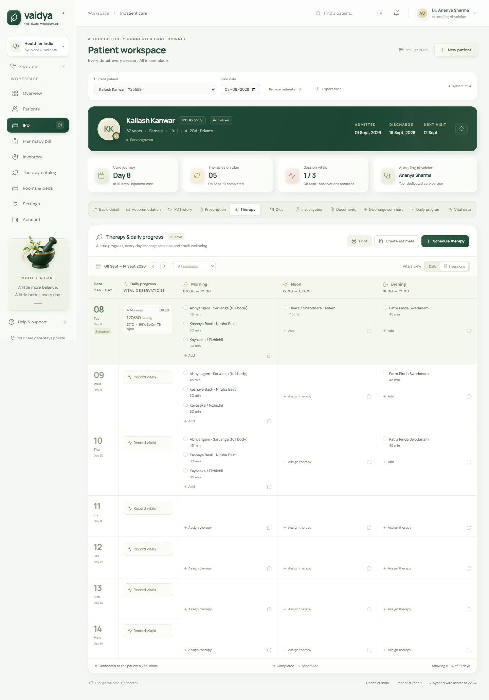

# Vaidya — patient care workspace

A working full-stack implementation of the supplied **VaidyaManager IPD patient portal** reference. The interface uses white clay surfaces, forest green, subtle gold, and an AI-generated botanical image with a genuine transparent background.



## Start locally

Requires **Node.js 24+** and npm.

```sh
npm ci
npm run setup
npm run dev
```

Open **http://127.0.0.1:5173**. Sign in with `ADMIN_EMAIL` and `ADMIN_PASSWORD` from your local `.env`. Setup generates a random password; it never prints or commits it. The database and administrator are created automatically on first start. Changing `ADMIN_PASSWORD` afterward does not rotate an existing account's password.

See [Everyday workflows](docs/WORKFLOWS.md) for a complete setup and daily-use guide.

The local API listens on `http://127.0.0.1:3001`. Vite proxies `/api` so browser requests use the same origin. No paid services or external API keys are required. Google Fonts is optional; the UI falls back to sans-serif if unavailable.

## What works

- Clinician login/logout with expiring server-side sessions, hashed passwords, HttpOnly cookies and CSRF protection.
- Patient directory, search, admission, demographics, attending physician, date validation and favourites.
- All eleven patient tabs: Basic detail, Accommodation, IPD history, Prescription, Therapy, Diet, Investigation, Documents, Discharge summary, Daily program and Vital data.
- Multi-date, multi-session therapy scheduling; tariff, alphabet and catalog search filters; completion and deletion; session notes.
- Daily or three-session vitals with independent upserts, explicit units, cross-tab synchronization and deletion. Switching views preserves existing records. Daily view uses the latest session record where a dedicated daily observation does not exist; session view shows session records.
- Persistent therapy estimates calculated from catalog prices and day counts. “All” includes three sessions per day. Saved plans can be scheduled across their advised days and converted into itemized invoices. Duplicate billing is prevented.
- Create, edit and delete prescriptions, diet plans, investigations, accommodation, history, daily programs and discharge summaries.
- Authenticated PDF/PNG/JPEG document uploads and downloads, 10 MB limit and file-signature validation.
- Connected prescribing and partial dispensing, inventory movements, low-stock thresholds, itemized invoices, partial receipts, and payment history.
- Room/bed capacity, transfers, accommodation charges and final discharge that releases the bed and closes later scheduled care.
- A date-specific care queue, follow-ups, patient/date switching, persistent navigation, CSV/JSON exports, vital trends, and printable invoices/summaries.
- Editable therapy catalogs/tariffs, physician directory, practice settings and clinician credentials.
- Responsive navigation, accessible modal focus handling, reduced-motion support and printable records.

The supplied case `25559` is seed/reference content. Additional tabs that were placeholders in the prototype now provide persistent record workflows. Catalog tariffs, stock counts and supplementary care records are illustrative seed values; they are not supplied clinical or pricing recommendations. The original `98.6 °C` unit mismatch is corrected to `37 °C`.

## API and configuration

See [API.md](docs/API.md) for all endpoints, input examples, units and errors. Authenticated `GET /api/schemas` returns JSON Schemas derived from the same Zod validators that the server uses. Environment options are documented in [.env.example](.env.example).

SQLite initialization is in `server/db.ts`; versioned, transactional upgrades are in `server/migrations.ts`. Existing records are preserved. `npm run backup` makes a consistent database and uploaded-file snapshot. Patient records, schedules, documents and activity are stored on the server, rather than browser localStorage. Refresh/focus reloads current server state; the workspace also refreshes every 30 seconds.

## Verify

```sh
npm run test
npm run build
npx playwright install chromium
npm run test:e2e
```

API tests use an isolated temporary database and cover authentication, CSRF, input validation, persistence, session modes, transactional scheduling and estimates, patient isolation, care record CRUD, file uploads, billing and inventory. Browser tests use separate API/frontend ports (`3101`/`5174`) and an isolated database under `test-results/`.

## Production deployment

The production app is available at **https://vaidya-ipd-care.vercel.app**.

Production uses two managed services:

- **Supabase project `vaidya-ipd-care`** (`dimjkfnqlcplomrivmcg`) hosts the PostgreSQL database and the private `patient-documents` Storage bucket.
- **Vercel project `vaidya-ipd-care`** hosts the Vite frontend and the Express API. Supabase does not run a persistent Node/Express web server, so the web/API runtime remains on Vercel while all durable application data is hosted on Supabase.

The Supabase schema is versioned in `supabase/migrations/`. To verify or deploy a schema change:

```sh
npx supabase link --project-ref dimjkfnqlcplomrivmcg
npx supabase db push --dry-run --remote
npx supabase db push --yes --remote
```

Required production environment variables are listed in `.env.example`. Keep `DATABASE_URL`, `SUPABASE_SERVICE_ROLE_KEY`, and `ADMIN_PASSWORD` secret. `DATABASE_URL` should use the Supabase session pooler; `SUPABASE_POOLER_HOST` is available for a pooler hostname override. The canonical production settings also use `NODE_ENV=production`, `COOKIE_SECURE=true`, and `APP_ORIGIN=https://vaidya-ipd-care.vercel.app`.

Deploy the web/API runtime after the checks pass:

```sh
npm run test
npm run build
npx vercel --prod
```

## Run the built app locally

```sh
npm run build
npm start
```

For local preview leave `NODE_ENV=development` and `COOKIE_SECURE=false`, then open `http://127.0.0.1:3001`. Without `DATABASE_URL` and Supabase credentials, local development uses SQLite and filesystem uploads. For a self-hosted production installation, configure `NODE_ENV=production`, `COOKIE_SECURE=true`, an HTTPS `APP_ORIGIN`, a strong `ADMIN_PASSWORD`, and `HOST=0.0.0.0` as appropriate. Terminate TLS at your reverse proxy and persist both `data/` and `uploads/`. The container recipe uses Node 24 and runs as a non-root user. Back up the SQLite database using SQLite's backup API or a consistent snapshot together with uploaded files.

This is a single-practice, single-clinician login implementation with a configurable physician directory. Multi-tenant access, clinician roles, external laboratory/pharmacy integrations and payment processing are not configured. Billing records track receipts and balances inside this workspace; they do not charge a payment method or process refunds. Use Settings to rotate the existing account password.

## Source and artwork

The original specification and interactive prototype are preserved in `reference/`. Artwork provenance, the exact generation prompt and transparent-image verification are in [ARTWORK.md](docs/ARTWORK.md). The runtime configuration, database, uploads, test outputs and local credentials are excluded from Git.
