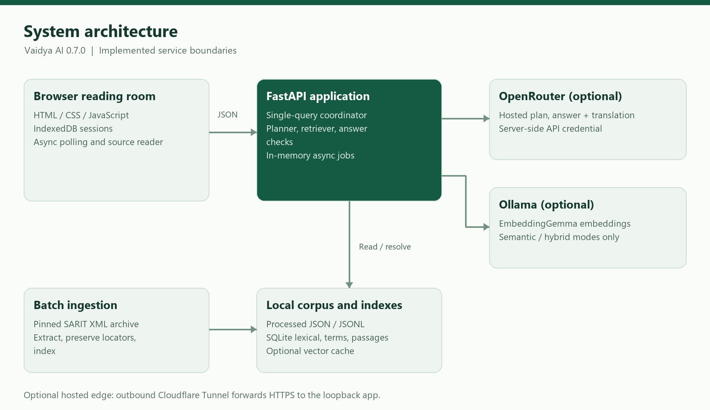
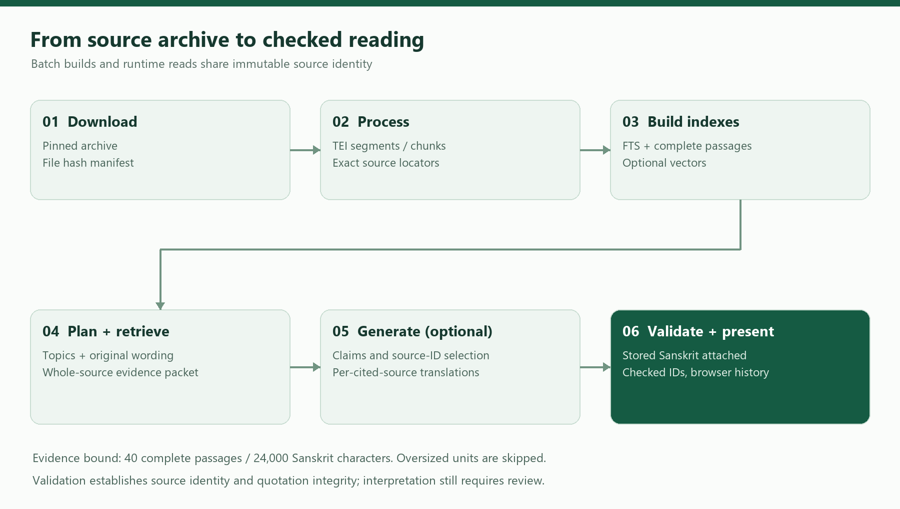

# Software Architecture Document

## 1. Purpose and document control

This document describes the implemented architecture of **Vaidya AI**, the reading-room application maintained in the **VedAI** repository. It supports technical handover, change impact analysis, operational ownership, and onboarding. Product branding is Vaidya AI; the Python package, CLI, deployment paths, and systemd units retain the name `vedai`.

| Control | Value |
|---|---|
| Document ID | VAI-HO-03 |
| Document version | 1.0 — implementation-based handover draft |
| Prepared | 11 November 2026 |
| Application version | 0.7.0 |
| Repository | https://github.com/AmRitJain0442/vedai |
| Inspected commit | `73beef60490f97bfbd2902db152ff99a6484456d` |
| Intended audience | Maintainers, architects, backend/frontend engineers, operations |
| Evidence boundary | Source inspected and local retrieval verified; hosted infrastructure and paid generation not revalidated |
| Acceptance | Repository owner and receiving maintainer review required; no approval is implied |

The other documents in this package cover API contracts (04), data storage (05), installation and operations (06), and user workflows (07). Implementation statements describe the pinned commit. Items explicitly called recommendations or future work are not shipped capabilities.

## 2. System overview and scope

Vaidya AI searches a pinned collection of historical Sanskrit Ayurveda texts, retrieves complete source units, and optionally asks a hosted language model to produce structured, cited readings and translations. It is a single-process application with a batch ingestion pipeline. The browser, Python API, local data files, and optional external model services form the principal boundaries.

The default retrieval mode is vocabulary-expanded BM25 over a normalized trigram index. Consequently, a configured language model or vector database is not required to search the collection. Semantic and hybrid modes are implemented as optional experimental alternatives. Hosted generation uses an OpenRouter adapter; local Ollama supplies embeddings only when vector features are used.

The application implements source browsing, English/Hindi/Sanskrit answer selection, search preferences, query-topic display, browser sessions, bounded follow-ups, and asynchronous job polling. The repository does not implement corpus upload through the UI, user registration, per-user server history, a distributed queue, token streaming, or a clinical decision engine. Historical statements and generated interpretations remain subject to expert review.

## 3. Architecture and trust boundaries

Figure 3.1 — The browser stores sessions locally. FastAPI coordinates retrieval, source resolution, and optional generation. The data build pipeline runs separately from normal reading requests.

| Boundary | Responsibilities | Data crossing the boundary |
|---|---|---|
| Browser ↔ FastAPI | Serve UI; ask questions; return readings and source data; poll jobs | Question, filters, answer language, up to four prior questions/summaries; reading JSON |
| FastAPI ↔ local files | Search indexes; resolve exact source units; validate build manifests | SQL queries, source hashes, stored Sanskrit and locator payloads |
| FastAPI ↔ OpenRouter | Optional planning and answer/translation generation | Current question, bounded conversation, search topics, selected source text |
| Retriever ↔ Ollama | Optional embedding creation and semantic query embedding | Source-title/text batches or prefixed query text; numeric vectors |
| Ingestion ↔ SARIT | Download pinned archive and retain provenance | Upstream corpus archive, XML files, per-file hashes |
| Deployment ↔ Cloudflare | Outbound demo tunnel to loopback application | HTTPS user traffic forwarded to `127.0.0.1:8765` |

API credentials stay on the server. Browser session records do not become a server-side history database. A follow-up nevertheless transmits selected prior user questions and bounded answer summaries to the API and, when configured, its model provider.

## 4. Technology stack

| Area | Implemented technology | Version or constraint | Role |
|---|---|---|---|
| Runtime | Python | ≥3.10 | Pipeline, retrieval, API, model adapters |
| Package/build | setuptools; `pyproject.toml` | setuptools ≥61 | Wheel/build metadata and CLI entry point |
| API | FastAPI | ≥0.115,<1 | Routes and request validation |
| Validation | Pydantic | Transitive dependency of FastAPI | Field bounds and request models; not directly pinned |
| HTTP server | Uvicorn | ≥0.30,<1 | Loopback ASGI server |
| Search storage | SQLite FTS5, JSON functions | Supplied by Python SQLite build | Lexical/trigram retrieval; JSON metadata filters |
| Numerical retrieval | NumPy | ≥1.26,<3 | Normalized float32 matrices; exact cosine scoring |
| Script conversion | indic-transliteration | ≥2.3,<3 | Devanagari/IAST normalization and display |
| Frontend | HTML, CSS, JavaScript | Browser native; no npm build | Responsive reading room and session UI |
| Browser storage | IndexedDB and sessionStorage | Browser native | Full session records; current-tab session selection |
| Hosted generation | OpenRouter chat-completions HTTP API | Model configurable | Strict JSON-schema planning and answers |
| Optional embeddings | Ollama; EmbeddingGemma | Model family checked by code | Local embedding build and query embedding |
| Tests | unittest, httpx, optional Playwright | httpx ≥0.27,<1 | Unit/API tests and browser checks |
| Documented hosting | Debian 12, systemd, GCP VM, cloudflared | cloudflared 2026.9.1 in bootstrap script | Recorded deployment arrangement |

There is no dependency lockfile in this snapshot. These constraints describe repository requirements, not a guarantee of compatibility with every future dependency release. There is no React/Next.js service, Node build, PostgreSQL instance, or hosted vector service in the implemented architecture.

## 5. Repository and component structure

| Path | Responsibility | Important interaction |
|---|---|---|
| `vedai/__main__.py` | CLI commands; Uvicorn startup | Dispatches batch tasks or creates the web app |
| `vedai/corpus.py` | Archive download, TEI extraction, chunk construction | Creates manifests and processed JSON/JSONL artifacts |
| `config/ayurveda.json` | Selected works and titles | Controls the 15-work ingestion selection |
| `vedai/search.py` | FTS5 lexical index and baseline search | Reads normalized chunk rows and original JSON payloads |
| `vedai/terminology.py` | Script normalization, draft vocabulary, trigram search | Reads `ayurveda_terms.json`; maintains terms manifest |
| `vedai/retrieval.py` | Retrieval modes, embeddings, rank fusion | Uses SQLite/NumPy and optional Ollama |
| `vedai/passages.py` | Complete verse/prose grouping and source lookup | Maps segment IDs to full passages; calculates term overlap |
| `vedai/query_planner.py` | Local/hosted search planning; search fan-out | Merges topic, original-question, and source-guide candidates |
| `vedai/source_guides.json` | Topic-specific navigation ranges | Selects stored adjacent passages without inventing evidence |
| `vedai/answers.py` | Provider adapter, structured answer contract, citation/translation validation | Resolves model-selected IDs to stored Sanskrit |
| `vedai/clinical.py` | Question types, claim bases, findings validation, output guidance | Separates textual evidence, interpretation, and case context |
| `vedai/scripts.py` | Deterministic Devanagari rendering | Adds display text without modifying stored citation text |
| `vedai/server.py` | HTTP API, middleware, single-query gate, ephemeral jobs | Coordinates all runtime components |
| `vedai/settings.py` | Restricted `.env` parser | Loads only three supported OpenRouter keys |
| `vedai/static/` | UI markup, styles, artwork and browser scripts | Same-origin calls; no separate frontend runtime |
| `vedai/evaluation.py`, `vedai/verify.py` | Retrieval metrics and artifact integrity | Produce machine-readable reports |
| `deploy/` | Package, bootstrap, install, update and service files | Operates a dedicated Linux VM deployment |
| `tests/`, `eval/`, `reports/` | Regression checks, draft evaluations, recorded results | Review material rather than runtime evidence sources |

## 6. Frontend architecture

`index.html` defines the question composer, search-preferences popover, landing suggestions, search-topic area, answer/source panels, sessions dialog, and source-reader dialog. `style.css` supplies the viewport-contained desktop layout and narrow-screen switches. `app.js` owns view state, input handling, request polling, result rendering, source navigation, and follow-up construction. `sessions.js` encapsulates IndexedDB persistence with a memory fallback.

At startup the browser concurrently requests `/works` and `/health` and opens `vedai-sessions`. It populates the work selector, restores or creates a session, and enables the composer. A submitted question is saved as a pending turn, sent to `/ask` with `Prefer: respond-async`, and polled through `/jobs/{id}`. The completed response is saved in its originating session before being rendered. A reading that completes after a session switch remains associated with its original session.

Full answers, citations, translations, locators, preferences, and job IDs reside in browser session records. Only the last four completed turns provide follow-up context; each outgoing answer summary is capped at 2,000 characters. Reopening an older reading does not move the context window back to that reading. Rendering uses DOM nodes and `textContent` rather than interpreting model text as HTML.

## 7. Ingestion and data-build architecture

Figure 3.2 — Batch ingestion preserves locators and source text; runtime retrieval supplies bounded evidence to generation.

1. **Download:** fetch the archive for SARIT revision `1eac9ee0b055c8d11147edac4a75c76008ccc363`, validate archive paths and record hashes. The full archive contains 110 files, including 88 XML files.
2. **Process:** parse the 15 selected works, retain TEI headers, section ancestry, XML IDs, page markers and language/layer tags. Prefer lemmas over variant readings and retain gaps under the extraction policy. Verify normalized body-text coverage.
3. **Segment:** emit 145,600 nonempty units, including headings and notes. Missing source language remains `und`.
4. **Chunk:** exclude headings and notes, split at a maximum of 1,800 characters, and preserve work, section, language and layer boundaries. Every reference records segment offsets. The verified snapshot contains 26,585 chunks.
5. **Index:** create lexical FTS5 and normalized trigram databases. Build full passage units and segment-to-passage mappings. The passage snapshot contains 111,195 complete source units.
6. **Optional embed:** call local EmbeddingGemma in batches, normalize vectors, cache completed rows, and record corpus/model/prompt identity. Manifest incompatibility requires an explicit rebuild into a consistent dataset.

Segment IDs depend on pinned revision, filename, and XPath; chunk IDs depend on serialized references; passage IDs depend on passage version and member segment IDs. They are 24-character SHA-256 prefixes, not verse numbers. Reprocessing after source or grouping changes can change IDs.

## 8. Request processing and RAG interactions

1. Validate question, work filter, language, limits, and conversation shape. Acquire the nonblocking, process-local query lock. A concurrent `/ask` receives HTTP 429.
2. Lazily construct `Retriever` and `PassageStore`. Constructors validate relevant manifests and source hashes. The passage store may create a source-locator expression index.
3. Build a local plan. If generation and enhancement are enabled and a provider is configured, request a strict hosted plan of one to four topics and one to six terms per topic. Invalid/unavailable planning falls back locally without an automatic paid retry.
4. Search each topic with unchanged filters. When no layer is selected, interleave base-text candidates. After successful hosted enhancement, independently search the original question. Local planning operates on the current question.
5. Resolve chunk references into complete passages. Source guides may add exact stored adjacent passages and reserve up to 24 candidate slots before the final fair merge. Guides provide navigation context, not proof of relevance.
6. Deduplicate by passage ID and combine search topics. Assemble at most 40 complete passages within 24,000 Sanskrit characters. Oversized units are skipped rather than clipped. The API `limit` controls retrieval breadth per search; it does not cap a successful generated reading to that many citations.
7. If generation is disabled or unconfigured, return retrieved sources and a descriptive generation status. Otherwise send the evidence packet and bounded conversation to OpenRouter for structured claims, findings and per-cited-source translations.
8. Resolve selected evidence IDs to exact stored Sanskrit. Reject unknown IDs, malformed claims, unsupported citation structure, invalid findings, and missing/duplicate/uncited translation entries. Return withheld-generation states when validation fails.
9. Attach deterministic Devanagari display, stored locators, query-plan coverage and stage timings. Persist only the temporary async result on the server; the browser saves its own complete reading.

The provider timeout defaults to 180 seconds for each HTTP call. A fully enhanced generated reading normally makes two sequential hosted calls, so clients should not assume a 180-second total deadline. There is no token streaming or cancellation endpoint. “Stop waiting” aborts browser waiting while server/model work may continue.

## 9. Retrieval modes and ranking decisions

| Mode | Candidate source | Requirements | Interpretation |
|---|---|---|---|
| `lexical` | Unicode-normalized FTS5 BM25 | Lexical database | Original OR-token baseline |
| `expanded` | Vocabulary-expanded normalized trigram BM25 | Terms database + compatible manifest | Default; finds Sanskrit forms inside compounds |
| `semantic` | Exact cosine scoring over float32 vectors | Complete vector build + matching Ollama model | Experimental; matrix loaded into process memory |
| `hybrid` | Expanded vocabulary ranking plus semantic ranking | Terms and vector requirements | Reciprocal rank fusion with `k=60` |

Final hits deduplicate normalized exact text. Work, layer, language and section-number filters constrain candidates. The displayed percentage is unique normalized query-term coverage, not semantic similarity, model confidence, medical probability or correctness. Source quotations and identity checks establish provenance; they do not mechanically establish that an interpretation follows from a verse.

Recorded draft natural-question recall@10 was 12.5% lexical, 6.25% semantic, 45.8% hybrid and 85.4% expanded over 48 work-filtered cases. These are historical development results predating later query enhancements, not scores measured for this handover and not general answer accuracy. The committed evaluation material requires expert review.

## 10. Runtime topology, security and state

The CLI binds Uvicorn to `127.0.0.1`; its own default port is **8000**. Repository examples and service files explicitly use **8765**. A single process owns a query lock and a dictionary of opaque jobs. Completed jobs expire based on age since creation after 900 seconds, and capacity management evicts completed jobs as the dictionary approaches 20 entries. Running jobs are not expired by that sweep. Cleanup occurs on job creation/polling; this is not durable queue infrastructure.

Optional HTTP Basic authentication is enabled by a nonempty `VEDAI_ACCESS_PASSWORD`. `VEDAI_REQUIRE_AUTH=1` without a password fails startup. `VEDAI_ALLOWED_HOSTS` extends the built-in loopback/test hosts. All routes pass through authentication middleware, and application responses receive CSP, no-store cache policy, no-referrer policy and nosniff headers. The OpenAPI endpoint remains enabled at `/openapi.json`; interactive docs pages are disabled.

The recorded deployment uses one Debian/GCP VM, an unprivileged service account at the operating-system level, a root-owned `/etc/vedai.env`, and an outbound Cloudflare Quick Tunnel. Repository deployment notes describe public access; current live access and VM state were not inspected. A changed Quick Tunnel hostname creates a different browser-storage origin. The app disables Uvicorn access logging but infrastructure/provider logging remains outside this assurance.

## 11. Quality attributes and operational constraints

| Attribute | Existing mechanism | Limitation / handover implication |
|---|---|---|
| Source integrity | Pinned archive, SHA-256 manifests, offsets and locator verification | Interpretation and translation still require expert review |
| Availability | Local retrieval survives absent generation credentials | Corrupt/missing indexes can fail asks even if `/health` returns HTTP 200 |
| Performance | Prebuilt FTS indexes; source-locator expression index | Exact semantic scoring and one-query gate limit scale |
| Concurrency | One in-flight ask per process | Multiple workers would split locks/jobs and break assumptions without redesign |
| Recoverability | Deterministic rebuild; resumable vector cache; code rollback archive | Browser history has no implemented portable backup/export UI |
| Privacy | Browser-local history; server-side keys; no application access logs | Follow-up context and evidence go to the configured hosted provider |
| Deployment control | Archive checksum; systemd sandbox; staged unit tests for code update | No committed CI/CD workflow or infrastructure-as-code plan |

## 12. Verification and receiving-team actions

For this handover, a clean clone was installed, the full pinned corpus was processed, all three default-runtime indexes were regenerated, and the integrity verifier was run. All 57 repository unit tests passed. Actual local API responses and nine UI screenshots (seven full views and two detail captures) were collected with hosted generation disabled. See `Reference/verification.json` for counts and scope.

Receiving maintainers should assign ownership of corpus updates, provider credentials/billing, VM operations, browser-history communication, and Sanskrit review. Recommended next work is to freeze deployment dependencies, replace the temporary hostname if stable access is needed, establish backup/restore drills and external availability monitoring, and redesign shared jobs/auth before introducing multiple workers. These are handover recommendations, not completed changes.

## 13. Source references and change map

All paths below refer to the inspected commit. `Reference/source-register.json` records source hashes and top-level symbol line numbers.

| Topic | Authoritative repository source |
|---|---|
| App composition, middleware, routes and jobs | `vedai/server.py` (`create_app`, line 53) |
| Answer orchestration and validation | `vedai/answers.py` (`answer`, line 254; `resolve_citations`, line 215) |
| Topic planning and evidence merge | `vedai/query_planner.py` (`retrieve_plan`, line 103) |
| Retrieval modes and vector identity | `vedai/retrieval.py` (`Retriever`, line 111) |
| Complete source units | `vedai/passages.py` (`PassageStore`, line 91) |
| Corpus provenance and extraction | `vedai/corpus.py`, `config/ayurveda.json` |
| Browser state/persistence | `vedai/static/app.js`, `vedai/static/sessions.js` |
| Dependency and service configuration | `pyproject.toml`, `deploy/*.service`, `docs/DEPLOYMENT.md` |

[Pinned repository snapshot](https://github.com/AmRitJain0442/vedai/tree/73beef60490f97bfbd2902db152ff99a6484456d)
