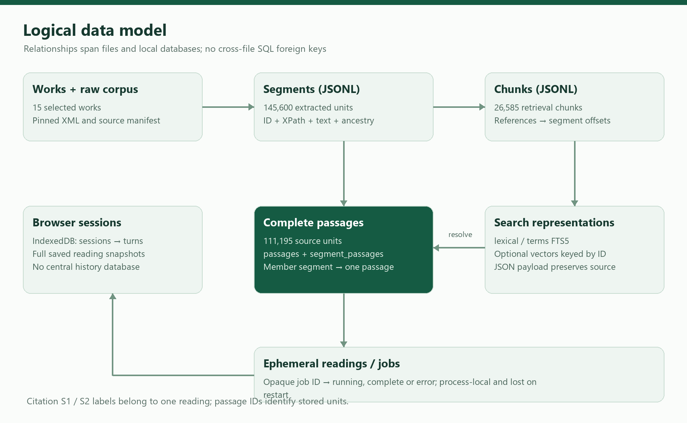

# Database Documentation

## 1. Document control and storage scope

| Control | Value |
|---|---|
| Document ID / version | VAI-HO-05 / 1.0 — implementation-based handover draft |
| Prepared | 11 November 2026 |
| Application | Vaidya AI / `vedai` 0.7.0 |
| Source commit | `73beef60490f97bfbd2902db152ff99a6484456d` |
| Audience | Maintainers, database/data engineers, operations and security reviewers |
| Evidence | Table builders, source payload construction, actual regenerated SQLite definitions |

Vaidya AI uses **local SQLite databases and UTF-8 JSON/JSONL files** for corpus/search data, **IndexedDB** for browser history, and a **Python dictionary** for temporary asynchronous jobs. It has no relational user/account database, ORM, hosted vector database, PostgreSQL schema, SQL migration directory, or database-managed row-level security.

Most server data is reproducible derived data. The pinned raw corpus and provenance manifest establish the source baseline; processed segments and indexes are rebuildable. User sessions are separate, browser-owned records and cannot be recovered by restoring the server's SQLite files.

## 2. Storage inventory and relationships



Figure 5.1 — Relationships across files/databases are enforced in application code and verification, rather than by cross-database foreign keys.

| Location under `data/` | Format | Purpose / lifecycle |
|---|---|---|
| `raw/SARIT-corpus-<revision>.zip` | ZIP | Pinned upstream archive retained for provenance |
| `raw/SARIT-corpus-<revision>/` | XML and upstream files | Full extracted snapshot used by process/verify |
| `source_manifest.json` | JSON | Revision, counts, file paths and SHA-256 inventory |
| `processed/works.json` | JSON array | Titles, source URL, languages, availability and processing metadata |
| `processed/works/<work>.jsonl` | JSONL | Per-work extracted segments |
| `processed/segments.jsonl` | JSONL | All extracted units, including notes/headings |
| `processed/chunks.jsonl` | JSONL | Search chunks, excluding notes/headings |
| `processed/headers/*.xml` | XML | Serialized original TEI headers and notices |
| `index/lexical.sqlite3` | SQLite FTS5 | Original keyword search and `/sources` lookup |
| `index/terms.sqlite3` + `terms.json` | SQLite FTS5 + JSON | Normalized vocabulary search and compatibility manifest |
| `index/passages.sqlite3` + `passages.json` | SQLite + JSON | Complete source units and segment mapping |
| `index/vectors.sqlite3` + `vectors.json` | Optional SQLite + JSON | Local embedding cache and complete-build manifest |
| `runtime/` | Local operational files | Packages, private deployment metadata, screenshots/logs; ignored by Git |

At the pinned snapshot there are 15 selected works, 145,600 extracted segments, 26,585 search chunks and 111,195 source passages. These full-corpus counts were reproduced for this handover. The vector report records 26,585 rows of 768-dimensional vectors from an earlier build; no vector build was performed for the handover.

One work has many segments, chunks and passages. A chunk has one or more references to segments or substrings of segments. One eligible segment maps to one passage; a passage may join several source segments, such as verse halves. A vector row is keyed to a chunk ID. Browser turns store reading snapshots; their citations are not rows joined to the server through SQL foreign keys.

## 3. Physical SQLite schema

`Reference/sqlite-schema.sql` contains DDL read from the regenerated default-runtime databases, plus the optional vector-table declaration copied from its builder. The following definitions reflect the implementation; FTS5 creates additional internal shadow tables which are managed by SQLite and should not be edited directly.

### 3.1 lexical.sqlite3 — chunks

```sql
CREATE VIRTUAL TABLE chunks USING fts5(
  id UNINDEXED,
  work,
  title,
  text,
  payload UNINDEXED,
  tokenize='unicode61 categories ''L* N* M*'''
);
```

| Column | FTS storage role | Description |
|---|---|---|
| `id` | Unindexed column | 24-character chunk ID; logical identifier, not a SQL PRIMARY KEY |
| `work` | Indexed text | Canonical work filename stem; also used for equality filtering |
| `title` | Indexed text | Normalized display title for search |
| `text` | Indexed text | Latin-diacritic-normalized chunk text; Devanagari marks retained |
| `payload` | Unindexed text | Original JSONL row containing unchanged source text and references |

The FTS virtual table provides a rowid and inverted index. There is no explicit unique constraint on `id`; pipeline verification checks uniqueness in source artifacts and equality with indexed IDs. Query ranking uses `bm25(chunks)` ascending after an OR expression over Unicode letter/number/mark tokens. Metadata filters use `json_extract(payload, ...)` and section-array traversal. No additional metadata B-tree index is declared for this table.

The index builder drops/recreates `chunks` and inserts all rows inside its SQLite connection/transaction scope. Treat it as an offline rebuild operation. Do not edit normalized search text expecting `/sources` to change; `/sources` returns `payload`.

### 3.2 terms.sqlite3 — terms

```sql
CREATE VIRTUAL TABLE terms USING fts5(
  id UNINDEXED,
  work UNINDEXED,
  text,
  payload UNINDEXED,
  tokenize='trigram'
);
```

| Column | FTS storage role | Description |
|---|---|---|
| `id` | Unindexed | Same logical chunk ID as processed chunks |
| `work` | Unindexed | Work filter value; no dedicated text index on work |
| `text` | Trigram indexed | Canonical IAST/Latin representation for substring retrieval |
| `payload` | Unindexed | Original chunk JSON, retaining exact indexed Sanskrit |

Canonicalization converts Devanagari to IAST where applicable, normalizes Latin diacritics, and removes editorial hyphens, apostrophes/avagraha-like punctuation and plus markers. Draft vocabulary mappings expand English/Hindi/Hinglish/Sanskrit queries into terms. The trigram tokenizer supports matching within compounds. Search terms shorter than three Latin characters are generally excluded by query-term processing.

The builder drops/recreates this table and writes `terms.json` with `version`, `source_sha256`, and `chunks`. The current version is `iast-substring-v2`; the source hash refers to `processed/chunks.jsonl`. Expanded/hybrid retriever construction rejects incompatible version/hash pairs. This check protects source/index consistency, not vocabulary accuracy.

### 3.3 passages.sqlite3 — passages

```sql
CREATE TABLE passages (
  id TEXT PRIMARY KEY,
  payload TEXT NOT NULL
);
```

| Column | Constraint | Description |
|---|---|---|
| `id` | TEXT PRIMARY KEY | Stable within the same source-grouping build identity; 24 lowercase hex characters |
| `payload` | TEXT NOT NULL | Full JSON source-unit object, schema below |

The source-unit text may be longer than a retrieval chunk. Grouping preserves work/layer/context and joins supported verse-half encodings, including adjacent numbered/un-numbered Ashtanga Sangraha paragraphs. Prose remains prose. Edition groups containing multiple printed verse numbers remain grouped. Missing numbering is preserved as missing; no model invents labels.

### 3.4 passages.sqlite3 — segment_passages

```sql
CREATE TABLE segment_passages (
  segment_id TEXT PRIMARY KEY,
  passage_id TEXT NOT NULL
);
```

| Column | Constraint | Logical relationship |
|---|---|---|
| `segment_id` | TEXT PRIMARY KEY | Identifier in `processed/segments.jsonl` |
| `passage_id` | TEXT NOT NULL | Many segment rows can reference `passages.id` |

There is **no declared SQL FOREIGN KEY** on `passage_id`. No FK is declared to segments, which live in JSONL. The primary key prevents multiple mapping rows for a segment. The passage builder inserts source units and mapping rows together; source resolution joins the mapping to `passages`. Application errors expose missing mappings rather than silently reconstructing source units. Notes/headings are excluded and should not be expected in this mapping.

### 3.5 passages source-locator index

```sql
CREATE INDEX IF NOT EXISTS passages_source_locator ON passages (
  json_extract(payload, '$.work'),
  json_extract(payload, '$.references[0].xml_ids[0]')
);
```

`PassageStore` creates this expression index when opened. It speeds guide lookups by work and first XML-ID prefix/range. It does not index every XML ID or replace the passage primary-key index. There is no separate index on `segment_passages.passage_id`; normal chunk-to-source resolution begins with the `segment_id` primary key. Even a primarily read-serving runtime needs index-directory write access for this lazy auxiliary index.

The passage manifest contains `version` (`source-passages-v2`), `source_sha256` of `processed/segments.jsonl`, and `passages` count. Missing, stale or mismatched manifests cause the passage store to fail with a rebuild message.

### 3.6 Optional vectors.sqlite3 — vectors

```sql
CREATE TABLE IF NOT EXISTS vectors (
  id TEXT PRIMARY KEY,
  text_hash TEXT NOT NULL,
  vector BLOB NOT NULL
);
```

| Column | Description |
|---|---|
| `id` | Corresponding processed chunk ID |
| `text_hash` | SHA-256 of UTF-8 encoded `title + text`, used for resumable row checks |
| `vector` | Unit-normalized NumPy float32 bytes; dimensions are described in the manifest |

There is no SQL vector extension, approximate-nearest-neighbor index, or declared FK. At runtime the semantic retriever loads all vectors into a NumPy matrix and computes exact dot products against a unit query vector. With the historical 768 dimensions, one raw vector occupies 3,072 bytes; the raw 26,585-row matrix is approximately 77.9 MiB, excluding Python/SQLite/chunk overhead.

The manifest records `model`, `model_digest`, `prompt_version`, `source_sha256`, `complete`, `chunks`, `dimensions`, `newly_embedded` and `seconds`. The current prompt version is `embeddinggemma-retrieval-v1`. Restarting the builder with identical identity skips rows whose text hash already matches. Batch commits preserve completed work. A changed model digest, source hash or prompt identity is rejected until old artifacts are moved aside or a new data directory is used.

## 4. JSON and JSONL data dictionary

### 4.1 Work metadata

`processed/works.json` is an array. Each object starts with configured `file`, `title`, optional `requested` and optional default `kind`, then adds source and extraction metadata:

| Field | Type | Meaning |
|---|---|---|
| `file` | string | Upstream XML filename; filename stem defines work ID |
| `title` | string | Configured human-readable title |
| `requested` | boolean | Whether included in the original nine requested works |
| `sha256`, `revision`, `source_url` | strings | XML content hash, pinned commit and original source URL |
| `language` | string | Root/body inherited default language, or `und` |
| `tei_titles`, `authors` | arrays | Retained title/author content from TEI header |
| `availability` | string/null | Original availability notice, whitespace normalized |
| `license_urls` | array | Retained Creative Commons links from availability markup |
| `body_text_coverage_verified` | boolean | Extraction coverage check succeeded |
| `segments`, `characters` | integers | Extracted unit count and total characters |
| `kinds`, `languages` | objects | Segment counts grouped by class/language |

The `/works` endpoint projects a subset of these fields. Licensing/attribution review should use the preserved availability statements and TEI headers, rather than assuming one license for every work.

### 4.2 Extracted segment

| Field | Type | Description |
|---|---|---|
| `id` | string | SHA-256 prefix of revision, XML filename and XPath identity |
| `work`, `title` | strings | Work ID and configured title |
| `kind` | string | `base-text`, `commentary`, `unknown`, `heading`, or `note` |
| `layer` | string | Commentary/base-text layer identity, sometimes annotation-derived |
| `language` | string | Inherited source-language tag; no fabricated default Sanskrit |
| `sections` | array | Structural ancestor objects |
| `xml_ids` | array | IDs in the emitted XML subtree |
| `labels` | array | Source label text |
| `xpath` | string | Namespace-aware TEI source location |
| `page` | string/null | Most recently encountered page milestone, if any |
| `source_url` | string | Pinned XML file URL |
| `text` | string | Exact extracted text under documented normalization policy |
| `inline_quotes` | array | Typed inline quotation metadata (`type`, `ana`, `text`) |

The extractor preserves Sanskrit Unicode and inline text, prefers lemma readings, emits nonempty notes separately, and verifies normalized visible-body coverage. It does not promise diplomatic byte-for-byte reconstruction of the original XML markup.

### 4.3 Shared structural and reference objects

A section object has `type`, `subtype`, `n`, `xml_id`, `xpath`, and `heading`. Nullable numbering/type metadata depends on the edition. Section ancestry is ordered from outer to inner structure. API chapter filtering compares a requested value to `n` anywhere in this array.

A reference object has `segment_id`, `xpath`, `xml_ids`, `labels`, `page`, `start`, and `end`. Offsets are zero-based, end-exclusive Python string character offsets in a segment, not UTF-8 byte positions. For example, `segment.text[start:end]` reconstructs a chunk contribution. Chunk text joins contributions with newline separators. Passage references use `start=0` and `end=len(segment.text)` for each complete member segment.

### 4.4 Search chunk

Chunk fields are `id`, `work`, `title`, `kind`, `layer`, `language`, `sections`, `source_url`, `text`, and `references`. Chunks contain at most 1,800 characters, exclude headings/notes, and do not cross work, section, layer or language boundaries. A long segment can contribute separate slices to several chunks. Chunk IDs hash the sorted-key JSON reference list and are not printed verse numbers.

### 4.5 Complete passage payload

Passage fields are `passage_id`, shared work/title/classification/sections/source URL, `form`, `verse_label`, `sanskrit`, `references`, and `source_text_sha256`. `form` is `shloka`, `prose`, or `commentary`. `verse_label` may be null, a source XML identifier, or stored printed-number text. `sanskrit` joins full source-member texts with newline separators. Its SHA-256 is calculated over UTF-8 bytes.

Runtime reading responses enrich passage payloads with citation IDs, chunk origins, query-term match, search topics, display-script text, and, when generated and validated, translation information. Those are response annotations; they are not all stored columns or persisted passage fields. Full examples are in `Reference/passage-response.json` and `Reference/ask-retrieval-response.json`.

## 5. Browser session database

| Item | Implemented setting |
|---|---|
| Database | IndexedDB `vedai-sessions` |
| Version | 1 |
| Object store | `sessions` |
| Key path | `id` |
| Secondary indexes | None |
| Tab selection | sessionStorage key `vedai-active-session` |
| Failure mode | Memory map for current tab with visible warning |

### 5.1 Session object

| Field | Type | Meaning |
|---|---|---|
| `id` | string | `crypto.randomUUID()` identity |
| `title` | string | Initial `New session`; first question's first 80 characters unless renamed |
| `renamed` | boolean | Preserves user-selected title against auto-title behavior |
| `created`, `updated` | numbers | `Date.now()` timestamps in milliseconds |
| `turns` | array | Ordered conversation records |

### 5.2 Turn object

| Field | Type | Meaning |
|---|---|---|
| `id` | string | UUID |
| `question` | string | Submitted current question |
| `settings` | object | Answer language, general-knowledge flag, work/layer filters |
| `created` | number | Millisecond timestamp |
| `status` | string | `pending`, `complete`, `interrupted`, or `error` |
| `job_id` | string | Conditional temporary server job reference; removed when completed |
| `result` | object | Conditional full reading response with source/translation data |
| `error` | string | Conditional status/recovery message |

Reads load all sessions and sort by descending `updated`; there is no server-side pagination or configured retention count. Transactions update a single session. Code avoids resurrecting a session deleted in another tab. Session switching resets visible preferences before restoring a selected reading's settings. Storage isolation follows browser profile and origin, including scheme, host and port.

Browser storage is not encrypted or protected by a separate application account. Anyone using the same browser profile/origin can inspect saved readings. Clearing site data, changing origin, or private-session eviction can remove access. There is no implemented export/import UI or cross-device synchronization.

## 6. Temporary job store

The server holds `jobs` in a Python dictionary guarded by a lock. Each internal entry has `status` and monotonic `created`, plus `result` or `detail` when finished. IDs are random 32-character hex values. Poll responses omit `created`.

Completed/error entries expire after 900 seconds from creation when a cleanup pass runs. Capacity management evicts completed entries while the dictionary has at least 20 entries before adding another. Running entries are exempt from age cleanup. No jobs are written to SQLite or recovered on restart. This store must not be treated as an archive, audit log or work queue.

## 7. Integrity rules, indexes and policies

| Concern | Existing control | Scope / limitation |
|---|---|---|
| Source provenance | Pinned revision and per-file SHA-256 manifest | Verify after download/restore and before accepting a changed corpus |
| Segment/chunk identity | Deterministic ID generation and verifier | FTS tables themselves do not enforce ID uniqueness |
| Chunk reconstruction | Offset, locator, boundary and coverage checks | Covers extraction/chunk integrity, not Sanskrit interpretation |
| Terms/passage freshness | Version and processed-source hash manifests | Startup/query initialization can reject stale artifacts |
| Vector freshness | Model digest, prompt version, source hash and completeness | Only EmbeddingGemma profile currently supported |
| SQL parameters | Parameterized identifiers/filters in read paths | No public write/query-SQL API |
| Access control | Application Basic auth and OS permissions | No SQL users, SQL grants, RLS or tenant policies |
| Filesystem isolation | Unprivileged systemd service; writable index directory | Raw/processed corpus should not be runtime-mutated |
| History policy | Browser profile/origin separation | No centralized retention or recovery service |

SQLite connection defaults are used; the code does not configure WAL mode, SQLCipher, database-level encryption, or custom PRAGMA policies. Physical access to corpus databases permits reads independent of web authentication. The release service uses `UMask=0077` and a root-owned mode-0600 environment file; these are operating-system controls, not database policies.

## 8. Maintenance and rebuild procedures

### 8.1 Standard rebuild

From the repository root, with the intended data directory selected consistently:

```bash
python -m vedai process
python -m vedai index
python -m vedai terms-index
python -m vedai passages-index
python -m vedai verify
```

Run `download` first on a clean environment. Stop reads or use a separate staging data directory during rebuilds; the multi-file set is not switched atomically by the CLI. Do not leave a new processed JSONL file with old SQLite/manifests. After changes to the corpus/model, rebuild optional vector artifacts under a compatible identity before selecting semantic/hybrid mode. Restart the application after replacing a coherent artifact set so cached retriever state is refreshed.

### 8.2 Diagnostic SQL

Use a Python/SQLite connection against a copied or maintenance-window database:

```sql
PRAGMA quick_check;
SELECT count(*) FROM chunks;
SELECT count(*) FROM passages;
SELECT count(*) FROM segment_passages;
SELECT count(*) FROM segment_passages AS s
LEFT JOIN passages AS p ON p.id=s.passage_id
WHERE p.id IS NULL;
```

`chunks` is in `lexical.sqlite3`; passage queries are in `passages.sqlite3`. Expected orphan count is zero. Do not execute all queries against the same database without selecting the correct file. To validate full-text index internal consistency during maintenance, use the FTS5 integrity-check command on the appropriate virtual table. FTS shadow tables should only be managed through supported SQLite commands.

The repository `verify` command checks raw hashes, segment/chunk IDs, chunk spans, normalized coverage and lexical IDs. It does **not** independently revalidate every passage, terms row or vector. Constructors and dedicated tests provide additional checks. The committed `reports/passages-integrity.json` is historical evidence; rebuilding the index is not equivalent to rerunning that historical exhaustive report generator.

## 9. Backup, restore and lifecycle recommendations

Recommended server backup scope is the repository commit/release manifest, pinned archive and source manifest, a coherent processed/index set and manifests, and separately protected runtime configuration. Stop the application for a simple consistent filesystem copy, or use SQLite backup APIs and coordinate the related JSON/manifest snapshot. Copying only one database is insufficient for a consistent rebuild identity. Keep real API credentials outside the general handover archive.

Restore into a staging location, validate archive checksums, run `PRAGMA quick_check`, run `python -m vedai verify`, initialize the selected retriever/passage store, and perform a retrieval-only `/ask`. Restart the service against the restored set only after these pass. Vector modes additionally require a locally installed matching model digest and an embedding smoke check. Define recovery time and recovery point objectives with the owner; no contractual RTO/RPO is encoded in the repository.

Browser history needs separate user communication. Restoring server disks does not restore deleted IndexedDB content. A stable origin preserves discoverability of existing local history; a new Quick Tunnel hostname isolates it. A future portable export/import feature would require implementation and review, and is not supplied by this handover.

## 10. Source references

| Storage behavior | Repository source |
|---|---|
| Lexical table and search | `vedai/search.py` |
| Terms table, normalization and manifest | `vedai/terminology.py` |
| Passage tables, grouping and expression index | `vedai/passages.py` |
| Vector cache and manifest guards | `vedai/retrieval.py` |
| Work/segment/chunk dictionaries | `vedai/corpus.py` |
| Browser schema and transactions | `vedai/static/sessions.js`, `vedai/static/app.js` |
| Ephemeral jobs and expiry | `vedai/server.py` |
| Integrity verification | `vedai/verify.py`, tests and committed reports |

[Pinned storage implementation](https://github.com/AmRitJain0442/vedai/tree/73beef60490f97bfbd2902db152ff99a6484456d/vedai)
