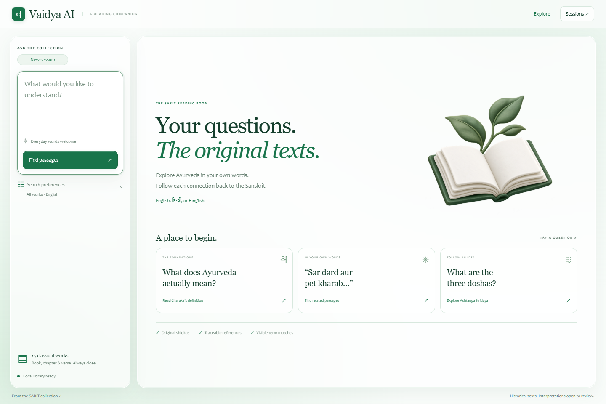
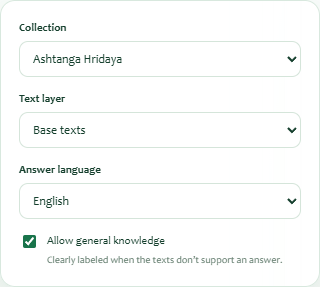
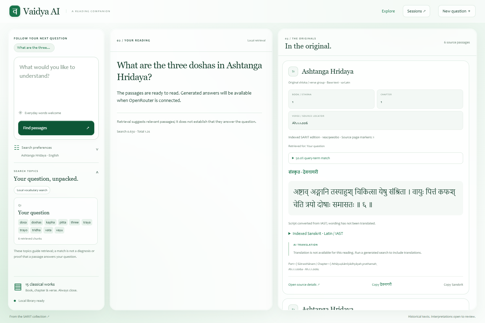
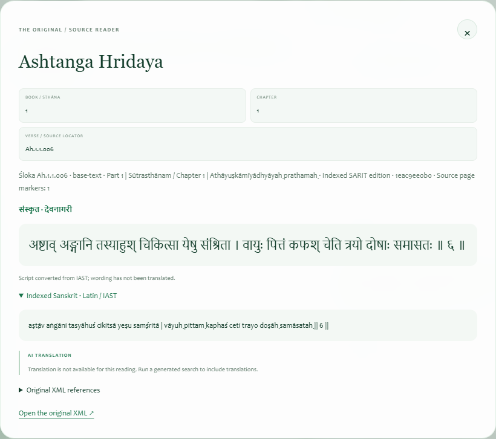
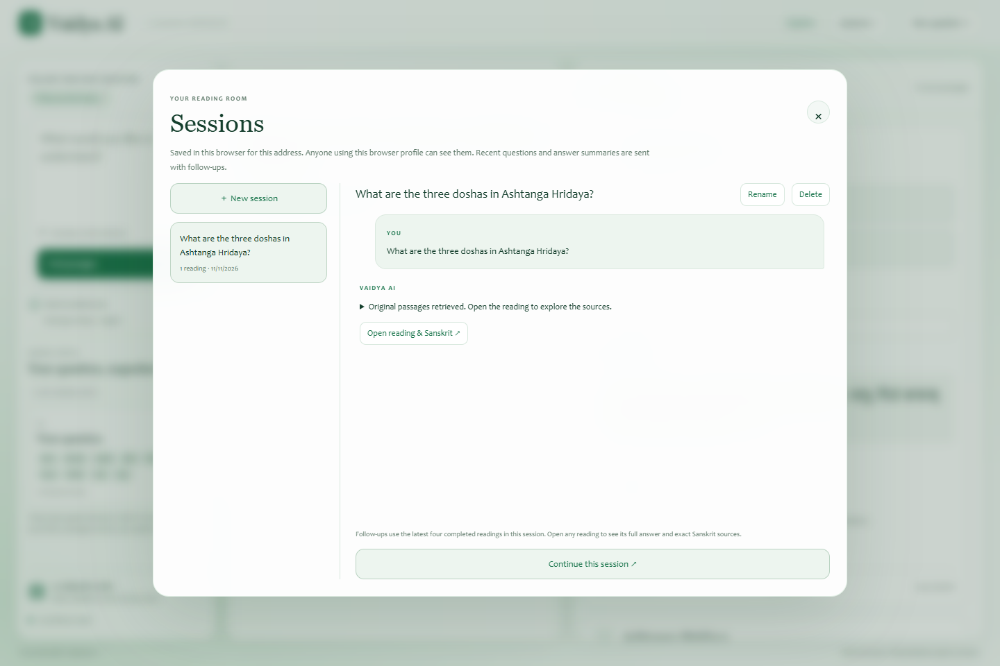
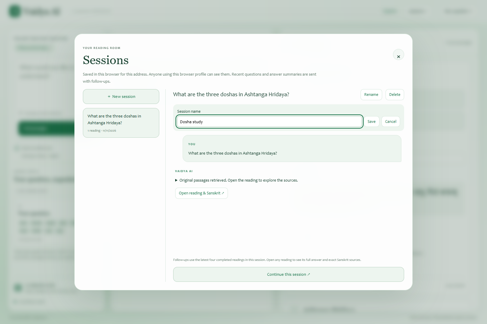
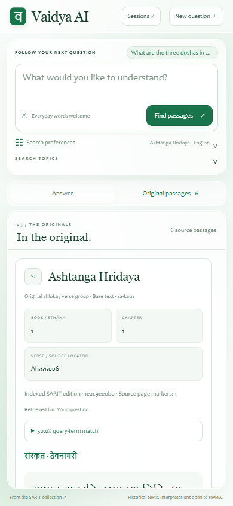

# User Manual

## 1. About this manual

| Control | Value |
|---|---|
| Document ID / version | VAI-HO-07 / 1.0 — implementation-based handover draft |
| Prepared | 11 November 2026 |
| Product | Vaidya AI reading room, maintained as VedAI 0.7.0 |
| Repository revision | `73beef60490f97bfbd2902db152ff99a6484456d` |
| Audience | Readers, researchers, subject reviewers and application demonstrators |
| Screenshot source | Actual local application with the full rebuilt 15-work corpus |
| Screenshot mode | Retrieval only; no hosted answer generation or fabricated output |

Vaidya AI helps you explore classical Ayurveda texts in your own words and inspect the original Sanskrit behind a reading. It searches the SARIT collection and can generate a structured explanation and translations when the operator has enabled the hosted model. It also works as an original-passage search tool without that connection.

This manual follows the visible product modules: the reading room, search preferences, search topics, answers, original passages, source details, sessions and mobile navigation. Generated clinical and translation behavior is explained from the implemented product contract; screenshots show the honestly available local retrieval mode. Your deployment may therefore show a model name and generated text where the screenshots show “Local retrieval.”

## 2. Open the reading room and identify its areas

1. Open the address supplied by your operator. For an installed local copy, use `http://127.0.0.1:8765` if the operator started it on port 8765.
2. If the browser asks for a username/password, enter the application credentials supplied by the operator. There is no separate registration screen.
3. Wait until the library connection indicator is ready and **Find passages** is enabled.
4. Locate the question box, **Search preferences**, suggested questions and **Sessions** control.

Figure 7.1 — The question composer is on the left. Starter questions on the right provide examples. **Sessions** opens readings saved in this browser.

| Area | What you can do |
|---|---|
| Question composer | Enter a question, then submit with Find passages or a keyboard shortcut |
| Search preferences | Select collection, text layer, answer language and general-knowledge setting |
| Starter questions | Run a prepared example, sometimes with a matching work/layer already selected |
| Search topics | Inspect the topic labels and search terms used for your reading |
| Your reading | Read generated claims or the retrieval-only explanation |
| In the original | Inspect source passages, term matches and source locations |
| Sessions | Create, switch, rename, delete and reopen browser-saved conversations |

The application contains 15 selected works, including Charaka Samhita, Sushruta Samhita, Ashtanga Hridaya, Ashtanga Sangraha, Bhela Samhita, Chakradatta and commentary/rasaśāstra works. It is a selected historical corpus, not an unrestricted web search or a complete edition-independent library.

## 3. Search module: ask your first question

1. Click the question box.
2. Type a specific question, for example **What are the three doshas in Ashtanga Hridaya?**
3. Optionally set the collection and layer as described in Section 4.
4. Click **Find passages**, or press **Ctrl + Enter**. On a Mac, **Command + Enter** also submits.
5. Wait while the application unpacks the question, retrieves passages and, if configured, generates a checked reading.
6. Read the result and inspect its sources before relying on an interpretation.

Questions can use English, Hindi, Sanskrit or Romanized/Hinglish wording. The input is limited to 2,000 characters. Very short or broad questions can return weak matches. To improve a search, name the concept, work or distinction you want to examine. For example, “How does Charaka define Ayurveda?” is more focused than “Ayurveda.”

To use a starter question, click its card. The example immediately submits and may set its intended collection/text layer. Review preferences before your next question if you want to search all works again.

### 3.1 What happens while waiting

The submit button changes to **Reading…**, and **Stop waiting** appears. Long readings run in the background. Generated readings can take longer because question planning, answer writing and source translation involve hosted calls. There is no fixed completion-time promise.

Click **Stop waiting** to stop the browser from waiting. Server work and a model request may continue. If a reading ID was received, open **Sessions** and choose **Resume waiting** on that unfinished reading. Resume uses the existing job instead of paying for another submission. The server keeps results only briefly; restart, expiry or eviction can make the ID unavailable.

Avoid immediately resubmitting the same question after stopping. Another query may still be running, and the shared server accepts one at a time. A busy message means to wait before trying again.

## 4. Search preferences module

1. Click **Search preferences** beneath the composer.
2. Choose the relevant **Collection**, or leave **All works**.
3. Choose **Text layer**: **Base texts & commentaries**, **Base texts**, or **Commentaries**.
4. Choose **Answer language**: **English**, **हिन्दी**, or **संस्कृतम्**.
5. Keep or clear **Allow general knowledge**, according to the type of answer you want.
6. Click back in the question box and submit. Preferences apply to the next search; changing them does not rewrite an already saved reading.

Figure 7.2 — The example narrows retrieval to Ashtanga Hridaya and base texts. The language selector controls generated explanation/translation language.

| Preference | Practical effect |
|---|---|
| Collection | Searches one selected work or the full selected collection |
| Text layer | Keeps base text/commentary identities distinct; commentary is not automatically the base text's wording |
| Answer language | Controls generated claims and AI translation/explanation; original Sanskrit is retained |
| Allow general knowledge | Permits clearly labeled uncited background when the corpus does not support the answer |

If you need a corpus-grounded reading, clear **Allow general knowledge**. This prevents unverified general/modern background from being presented as an allowed fallback. It does not guarantee the collection contains an answer, and evidence gaps or focused follow-up questions may still appear.

Selecting Hindi does not translate the source corpus in advance. Translations are generated for cited source units when generation is available. Sanskrit answer mode produces a simpler Sanskrit explanation. The browser does not expose a chapter selector, a source-language filter, retrieval-mode switch, or model settings; those are API/administrator controls.

## 5. Search-topics module: understand how the question was searched

After a search, expand **Your question, unpacked.** in **Search topics** if it is closed. The panel shows one or more topic cards with terms and retrieved-chunk counts.

1. Read the plan status: **AI-enhanced search**, **Local vocabulary search**, or **Local search fallback**.
2. Check that the topic names reflect your question, including its negations or distinctions.
3. Review the terms. Colloquial wording can expand into tentative Sanskrit search terms.
4. Where a supported generated answer is present, compare retrieved counts with cited-passage counts.
5. If the plan misses your intent, rewrite the question more explicitly or narrow the collection.

For a Hinglish question mentioning both head pain and digestive symptoms, separate topics can be searched. These topic labels are retrieval aids, not diagnoses. A topic can retrieve text without finding a passage that supports an answer. When hosted enhancement succeeds, original wording is searched independently as well. Source-navigation guides may add adjacent stored passages for context.

The local retrieval screenshot below includes a genuine search-topics panel. It shows the locally available plan rather than simulating a hosted model response.

## 6. Answer module: read the result correctly

Figure 7.3 — This actual result is retrieval-only. The right panel contains original passages even though no generated answer/translation is available.

On desktop, the answer and original-source areas scroll independently. The model label identifies the configured generator or says **Local retrieval**. The result includes elapsed search/total time; these values describe the current reading and are not service guarantees.

### 6.1 Recognize the type of reading

| Visible outcome | Meaning / next step |
|---|---|
| Corpus answer / source references checked | Generated textual claims cite current source units; inspect each citation |
| Textual evidence + separate clinical context | Some claims are cited and some are explicitly uncited; read each basis label |
| General knowledge / no verified corpus reference | Background answer not supported by the retrieved corpus; no book/verse citation is claimed |
| Limited evidence | The collection did not establish the requested conclusion; inspect gaps and focused follow-ups |
| Passages ready; generation unavailable | Search succeeded without a configured or working generator; read the originals |
| Answer did not pass citation checks | Generated output was withheld; retrieved passages remain available |

A source check confirms that an ID and quotation match stored text. It does not independently verify interpretation, translation accuracy, clinical conclusions or whether every claim follows from the passage. Read the surrounding source context and obtain subject review when needed.

### 6.2 Follow a citation

1. Find a citation button such as **S1** beside a generated claim.
2. Click it.
3. The original-passages view opens where needed and brings the corresponding source card into view.
4. Read the full passage, its edition/section locator and any associated translation.
5. Use **Open source details ↗** for the larger source reader.

Citation labels such as S1 belong to the current reading. They are not universal verse identifiers and can refer to a different passage in another search. No generated citation buttons appear in the retrieval-only screenshot because it contains no generated claims.

## 7. Original-passages module

Each source card identifies the title, base-text/commentary layer, source language and available book/chapter/verse information. It can also show retrieval topics, term coverage, original Sanskrit, AI translation and source actions.

### 7.1 Understand locations and source types

The card's **Book / sthāna**, **Chapter**, and **Verse / source locator** fields come from the edition's stored structure. Some editions do not number every level. **Not numbered in source**, **unnumbered**, or an XML locator is preferable to an invented reference.

The source may be an original śloka/verse group, prose, or commentary passage. A source group can contain several printed verse numbers, and split verse halves can be joined according to the edition. Do not assume each card equals exactly one printed verse in every edition. Page markers are shown when present; a displayed marker is not a full modern printed-page mapping.

### 7.2 Read query-term match

1. Expand the percentage labeled **query-term match**.
2. Read the matched terms and the total term count.
3. Compare the actual passage with the question rather than ranking truth by the percentage.

The percentage measures how many unique normalized search terms occur in the passage. A 100% match is not a 100% correct answer, a diagnosis probability, or a measure of translation quality. A lower match can still provide useful context; a high match can merely mention the same words without answering the question.

### 7.3 Read Sanskrit and translations

The app displays Devanagari first when available. If the source was indexed in IAST, it adds the note **Script converted from IAST; wording has not been translated.** Expand **Indexed Sanskrit · Latin / IAST** to inspect the original stored wording. Native Devanagari text is preserved.

An **AI TRANSLATION** block appears for generated, cited sources. Its language follows the answer-language setting; Sanskrit mode is labeled as an explanation. The translation is AI-generated and not expert-reviewed. An unavailable translation message means there is no reliable generated rendering for that source. In retrieval-only mode, the originals remain readable while translations are unavailable.

### 7.4 Copy a source

1. Click **Copy देवनागरी** to copy the displayed Devanagari text, when provided.
2. Click **Copy Sanskrit** to copy the unchanged original indexed text, which may be IAST.
3. Watch the confirmation toast.
4. If browser permissions block copying, open source details and select the text manually.

Copy buttons copy source text; they do not automatically create a formatted bibliography or include every locator. Retain the book/section/XML references separately when preparing research notes.

## 8. Source-reader module

1. On a source card, click **Open source details ↗**.
2. Read the title, source type/layer and section path.
3. Inspect the available book/chapter/verse fields and original Sanskrit.
4. Expand **Indexed Sanskrit · Latin / IAST** if present.
5. Expand **Original XML references** for exact segment IDs, XML IDs, XPath and offsets.
6. Click **Open the original XML ↗** to open the pinned upstream XML file in another tab.
7. Close with the **×** button or **Escape**.

Figure 7.4 — The source reader preserves original wording and edition locations. The screenshot shows the expanded original IAST text; no AI translation was generated.

The upstream link opens an XML file, not a rendered verse viewer. It may therefore require locating the stored XML ID/XPath within the file. Network or repository access conditions can affect the link independently of local passage access.

## 9. Sessions module: save, organize and reopen readings

Sessions are automatically saved in the current browser profile for the current application address. There is no account-based server history. Each reading retains its full response, original source passages, translations when present, preferences, locators and search plan.

Figure 7.5 — Session names appear on the left; the selected conversation and saved-reading actions appear on the right.

### 9.1 Create a new session

1. Click **Sessions** in the top navigation, or click the current-session badge above the question box.
2. Click **＋ New session**.
3. The dialog closes and a fresh composer opens without earlier conversation context.
4. Ask a question. The session title initially follows the first question, up to 80 characters.

### 9.2 Switch sessions and open a reading

1. Open **Sessions**.
2. Select a session from the left-hand list.
3. Expand an answer preview to read its saved summary/full answer text in history.
4. Click **Open reading & Sanskrit ↗** to restore the complete reading and original sources.
5. Use **Continue this session ↗** when you want to return to the composer and ask a follow-up.

Switching or reopening a saved completed reading does not repeat a paid model request. Its result is loaded from browser storage. A future follow-up creates a new request with the current session's bounded context.

### 9.3 Rename a session

1. Open **Sessions** and select the intended session.
2. Click **Rename**.
3. Enter a descriptive name of up to 80 characters, for example **Dosha study**.
4. Click **Save**, or **Cancel** to keep the previous name.

Figure 7.6 — Renaming changes the local session title. It does not change source data or create a server account.

### 9.4 Delete a session

1. Open **Sessions** and select the session carefully.
2. Click **Delete**.
3. Read the confirmation prompt identifying that all readings in the session will be removed from this browser.
4. Click **Delete session** to proceed, or **Keep session** to cancel.

There is no implemented undo or server recovery for deleted sessions. The currently running session cannot be deleted through the UI until its active wait ends. This deletion changes browser history, not the shared Sanskrit corpus.

### 9.5 Resume an interrupted reading

1. Open the session containing the unfinished turn.
2. If **Resume waiting** is offered, select it.
3. Keep the tab open while the app reconnects to the saved server job.
4. If the reading has expired or the server restarted, decide whether to submit the question again.

Only jobs still retained by the same server process can resume. Stopping the browser wait, closing the tab, and restarting the server have different effects. The server may continue work after the first two; server restart loses the job entirely.

## 10. Follow-up questions and New question

After a reading, use **New question** to clear the visible result while staying in the same session, or simply type another question in the composer. Both continue the session. **New session** starts a separate conversation without previous context.

1. Read the current answer and sources.
2. Enter a focused follow-up, for example **Explain the first one in more detail.**
3. Submit it in the same session.
4. Inspect newly retrieved sources; previous citations do not automatically become verified evidence for the new reading.

The latest **four completed readings** supply follow-up context. Each outgoing answer summary is limited to 2,000 characters. Older readings remain in history but are outside model context. Opening an older reading does not select a different conversation branch: subsequent questions still use the session's latest completed readings.

When hosted planning is unavailable, the local search uses the current question only. In that situation, spell out the subject instead of using “the first one” or “it.” A clear standalone follow-up is more reliable than assuming full conversation memory.

## 11. Structured clinical and subject-specific readings

The application can adapt generated readings to textual questions, substances, formulations, diet, disease, procedures, examination and patient-case discussion. These are response structures within the same question/answer workflow, not separate menu pages.

When a generated reading contains mixed information, inspect the basis labels:

| Label | How to read it |
|---|---|
| Direct textual evidence | A statement with current corpus references |
| Interpretation of the text | An inference from supplied sources, requiring review |
| General knowledge / Modern context | Uncited background, not source-verified evidence |
| Clinical priority | A separate assessment priority, not a Sanskrit citation |
| Evidence gap | Information the available evidence has not established |
| What would change the decision | A focused follow-up question |

For case questions, expand **Case details: present, absent and unknown** when shown. **Reported present** and **Explicitly absent** are tied to user wording; **Not established** is missing information, not a normal finding. Corrections in your current question should be explicit.

Historical treatment passages describe what a text says; they do not by themselves establish a personalized treatment, dose or current medical diagnosis. The app separates such context from textual evidence and withholds structurally invalid output, but those controls do not replace qualified interpretation. No clinical efficacy or diagnostic validation is claimed by this manual.

## 12. Mobile layout and accessibility

On a narrow screen, the answer and original passages use view switches instead of the full desktop side-by-side arrangement.

1. Submit or reopen a reading.
2. Tap **Answer** to read the explanation.
3. Tap **Original passages** to read source cards.
4. Tap a generated citation to move to its source.
5. Close preference/topic popovers after making a selection to recover reading space.

Figure 7.7 — The actual 390 × 844 mobile view showing the original-passages tab. Desktop screenshots were captured at 1440 × 960.

The UI includes a **Skip to question** link, labeled controls, visible focus behavior, keyboard submission and status announcements. **Escape** closes dialogs and open popovers where implemented. Scroll within the answer/source areas when content exceeds the viewport. Clipboard access can vary with browser permissions; manually selecting text remains a fallback.

## 13. Privacy, storage and practical limitations

Readings belong to the browser profile and application origin, including its scheme, hostname and port. Another browser/device will not show them automatically. Anyone with access to the same browser profile can inspect them. If the browser cannot open persistent storage, a warning explains that sessions are held only in the current tab and can be lost on refresh.

Clearing site data can remove history. Private browsing may discard it. A changed temporary Cloudflare address uses different storage, so old sessions may appear absent at the new address even if the old origin's data still exists. There is no built-in export/import or cross-device sync. Avoid entering confidential personal information unless your operator's data-handling arrangements permit it: the current question, selected prior questions/summaries and retrieved evidence can be sent to the hosted model provider.

The library may have edition gaps. Missing numbers, untranslated passages, uncertain retrieval and rejected answers should remain visible rather than being silently filled. The application does not search the live web for current facts or supply a verified modern literature review.

## 14. Troubleshooting and support

| Problem | What to do |
|---|---|
| Find passages is disabled on first load | Wait for catalog/health initialization; ask the operator if it does not finish |
| Preparing the search index | The operator must finish or repair ingestion/indexes |
| A query is already running | Wait before submitting; another visitor or your stopped reading may occupy the slot |
| No useful passages | Narrow the concept, name the work, change layer or use explicit Sanskrit/English terminology |
| No generated answer/translation | Read available originals; ask the operator whether generation is enabled |
| Answer withheld by citation checks | Inspect retrieved sources; do not treat the withheld text as an accepted answer |
| Resume fails / reading expired | The temporary job is unavailable; decide whether to submit a new question |
| Saved sessions disappeared | Check browser profile, address and site-data clearing; they are not held on the server |
| Copy unavailable | Open source details and select/copy manually |
| Sign-in prompt repeats | Confirm application credentials with the operator; do not use your model API key |
| Upstream XML does not open | Check network/repository access; the in-app stored passage may still be readable |

When reporting a problem, provide the application address, time, browser/device, visible message, relevant question/filter details if appropriate to share, and whether it involved a saved or new reading. Never include API keys or passwords. Operators can use the technical guides to inspect service/index/provider issues.

## 15. Quick practice exercise

1. Open the reading room and choose **Ashtanga Hridaya**, **Base texts**, and **English**.
2. Ask **What are the three doshas in Ashtanga Hridaya?**
3. Inspect **Search topics** and the first source's location.
4. Expand term-match details and original IAST, if available.
5. Open source details, inspect XML references, then close the dialog.
6. Copy Sanskrit and confirm which script was copied.
7. Open **Sessions**, rename the conversation **Dosha study**, and reopen its reading.
8. Start a **New session** to ask an unrelated question without prior context.

Completing these steps exercises the principal modules without requiring generated output. When the operator enables generation, repeat the reading and additionally inspect claim citation buttons and per-source AI translations.

## 16. Reference and verification

The UI behavior described here is based on `vedai/static/index.html`, `app.js`, and `sessions.js`. Generated answer/translation behavior is defined in `vedai/answers.py` and `vedai/clinical.py`. Screenshots were captured on 11 November 2026 from unmodified application code at the inspected commit; hosted model output was deliberately not simulated. `Reference/verification.json` records the capture conditions.

[Pinned frontend implementation](https://github.com/AmRitJain0442/vedai/tree/73beef60490f97bfbd2902db152ff99a6484456d/vedai/static)
